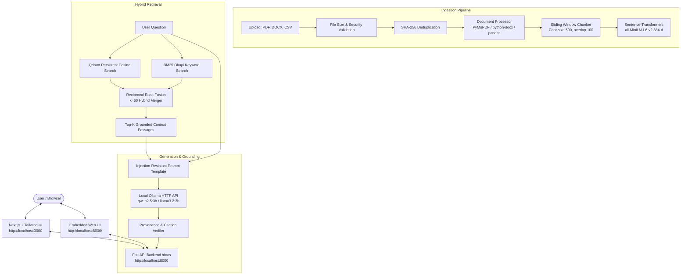

# NexusRAG

A locally runnable, reliable, and enterprise-grade **Retrieval-Augmented Generation (RAG)** platform. NexusRAG enables users to upload heterogeneous documents (PDF, DOCX, CSV), query them in natural language, and receive grounded answers backed by verifiable source citations and relevance scores.

NexusRAG is designed to run completely on-premise on Windows 11 (tested on Python 3.13.7) with zero mandatory cloud dependencies, conservative memory allocation for 16 GB RAM and 4 GB VRAM, persistent vector storage, and native local LLM inference via Ollama.

---

## Architecture Overview



---

## Core Capabilities

1. **Document Ingestion**:
   - Native parsing of PDF (via `pymupdf`), DOCX (paragraphs and tables via `python-docx`), and CSV (row extraction via `pandas`).
   - SHA-256 content deduplication prevents re-indexing duplicate files.
   - Strict file validation: 25 MB limit, extension whitelisting, filename sanitization, and path traversal prevention.
2. **Chunking & Metadata**:
   - Configurable character-based sliding window with overlap (default: 500 chars, 100 overlap).
   - Word boundary preservation avoids cutting words in half.
   - Enriches each chunk with `document_id`, `source`, `page`, `row`, `chunk_index`, and upload timestamp.
3. **Embeddings & Vector Store**:
   - `sentence-transformers/all-MiniLM-L6-v2` generating 384-dimensional normalized vectors.
   - Local CPU inference by default to preserve GPU VRAM for the local LLM.
   - Persistent Qdrant vector database stored on disk in `data/qdrant/`.
   - Supports document-level filtering, document deletion, and re-indexing.
4. **Hybrid Retrieval with Reciprocal Rank Fusion (RRF)**:
   - Dense semantic vector search + BM25 lexical keyword retrieval (`rank_bm25`).
   - Fuses rankings using:
     $$\text{RRF Score}(d) = \sum_{m \in \{\text{dense}, \text{bm25}\}} \frac{w_m}{k + \text{rank}_m(d)}$$
     *(where $k=60$, $w_{\text{dense}}=1.0$, $w_{\text{bm25}}=1.0$)*.
5. **Local Generation via Ollama**:
   - Communicates strictly with local Ollama HTTP API (`http://localhost:11434`).
   - Graceful offline detection with setup and model pull instructions.
   - Strict grounding: instructs the model to answer only from context and state: *"I do not have sufficient information in the provided documents to answer this question"* when evidence is insufficient.
   - Prompt injection defense: wraps retrieved excerpts in untrusted context tags and instructs the model to disregard instructions contained within files.
6. **Verifiable Citations**:
   - Returns structured citation badges with source filename, page/row/chunk numbers, and similarity scores.
7. **Multi-Turn Conversation**:
   - Bounded chat history memory retaining the last 4–6 turns while re-retrieving evidence for each factual question.
8. **Dual UI Access**:
   - **Next.js + TypeScript + Tailwind CSS** application in `frontend/`.
   - **Embedded Dashboard** served directly on `http://127.0.0.1:8000/` for instant zero-npm browser preview.

---

## Hardware & System Requirements

- **Operating System**: Windows 11 (64-bit)
- **Python**: Python 3.13.7 (or >= 3.10)
- **Node.js**: Node.js >= 18 (Node.js 22 tested)
- **RAM**: 16 GB RAM recommended
- **VRAM**: 4 GB VRAM (sufficient for compact 3B models such as `qwen2.5:3b` or `llama3.2:3b`)

---

## Installation & Setup

### 1. Clone & Navigate to Project
Open Windows PowerShell:
```powershell
cd E:\NexusRAG
```

### 2. Activate Virtual Environment
```powershell
.\venv\Scripts\Activate.ps1
```
*(If PowerShell restricts script execution, run `Set-ExecutionPolicy -ExecutionPolicy RemoteSigned -Scope CurrentUser` once).*

### 3. Install Python Dependencies
```powershell
pip install -r requirements.txt
```

### 4. Configure Environment
Copy `.env.example` to `.env`:
```powershell
Copy-Item .env.example .env
```

---

## Local Ollama Setup Guide

NexusRAG uses Ollama for local private LLM inference.

1. **Install Ollama on Windows**:
   ```powershell
   winget install Ollama.Ollama
   ```
   Or download the official installer from [ollama.com/download](https://ollama.com/download).

2. **Start the Ollama Server**:
   ```powershell
   ollama serve
   ```

3. **Pull a Recommended Model (Optimized for 16GB RAM / 4GB VRAM)**:
   ```powershell
   ollama run qwen2.5:3b
   ```
   *Alternative lightweight models:*
   ```powershell
   ollama run llama3.2:3b
   ollama run mistral:7b
   ```

4. **Verify Connectivity**:
   ```powershell
   .\scripts\check_ollama.ps1
   ```

---

## Running the Application

### Option A: Start FastAPI Backend (with Embedded UI)
Run in PowerShell:
```powershell
.\scripts\run_backend.ps1
```
Or directly:
```powershell
.\venv\Scripts\python.exe -m uvicorn app.api.main:app --host 127.0.0.1 --port 8000 --reload
```

- **Interactive Web App**: [http://127.0.0.1:8000/](http://127.0.0.1:8000/)
- **Swagger API Documentation**: [http://127.0.0.1:8000/docs](http://127.0.0.1:8000/docs)
- **Health Check Endpoint**: [http://127.0.0.1:8000/api/health](http://127.0.0.1:8000/api/health)

### Option B: Start Next.js Frontend
In a second PowerShell window:
```powershell
.\scripts\run_frontend.ps1
```
Or manually:
```powershell
cd frontend
npm install
npm run dev
```
Open [http://localhost:3000](http://localhost:3000) in your browser.

---

## API Documentation

| Method | Endpoint | Description |
| :--- | :--- | :--- |
| `GET` | `/` | Root endpoint / Serves embedded UI in browser |
| `GET` | `/api/health` | Health check (Qdrant point count & Ollama connection) |
| `GET` | `/api/status` | System status, embedding specs & Ollama diagnostics |
| `POST` | `/api/upload` | Multipart file upload (`.pdf`, `.docx`, `.csv`, max 25MB) |
| `GET` | `/api/documents` | List all indexed documents and metadata |
| `DELETE` | `/api/documents/{id}` | Delete a document from Qdrant, BM25, and disk |
| `POST` | `/api/query` | Single-shot RAG query with source citations |
| `POST` | `/api/chat` | Multi-turn conversation endpoint with session memory |
| `DELETE` | `/api/chat/{session_id}` | Clear conversation session |
| `GET` | `/api/models` | List installed Ollama models and status |

---

## Reranking Tradeoffs

NexusRAG implements **Reciprocal Rank Fusion (RRF)** by default. Here is why:

| Metric | Reciprocal Rank Fusion (Default) | Cross-Encoder Reranker |
| :--- | :--- | :--- |
| **Inference Latency** | ~0.5 ms (zero GPU/CPU neural load) | ~150–300 ms per query (CPU) |
| **Memory Footprint** | 0 MB additional RAM | ~400–800 MB additional RAM |
| **Precision** | Excellent (merges dense semantic + exact lexical) | Marginally higher on ambiguous queries |
| **Local Viability** | Ideal for 16GB RAM / 4GB VRAM | Can throttle concurrent requests |

---

## Evaluation Framework

NexusRAG includes an automated retrieval and grounding evaluation suite in `app/evaluation/`.

### Run Benchmark Suite:
```powershell
.\venv\Scripts\python.exe scripts/run_evaluation.py
```

### Metrics Computed:
- **Precision@K** ($k=1, 3, 5$): Ratio of retrieved chunks matching ground truth.
- **Recall@K** ($k=1, 3, 5$): Ratio of ground-truth evidence captured in top-$k$.
- **Mean Reciprocal Rank (MRR)**: Reciprocal rank of first relevant item.
- **Context Relevance Score**: Heuristic token coverage of query within context.
- **Faithfulness Score**: Heuristic n-gram containment verifying generated claims against retrieved context passages.

*(Note: Automated heuristic scores provide fast reproducible baselines; human evaluations remain the gold standard for qualitative nuance).*

---

## Running the Automated Test Suite

Run all unit, integration, and security tests:
```powershell
.\venv\Scripts\python.exe -m pytest -v
```

All 50 unit and integration tests run offline without downloading models or requiring an active Ollama instance.
